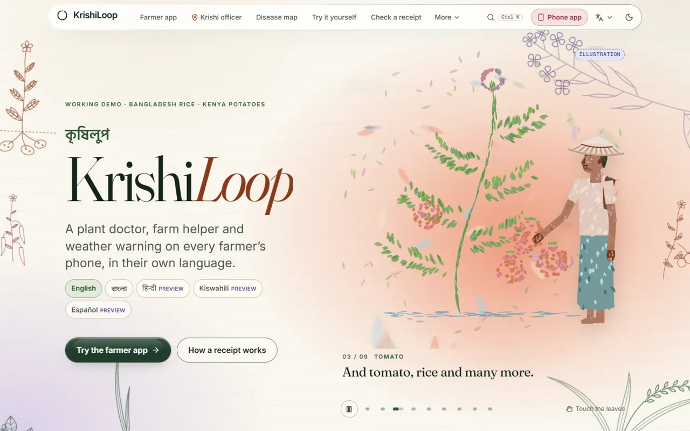
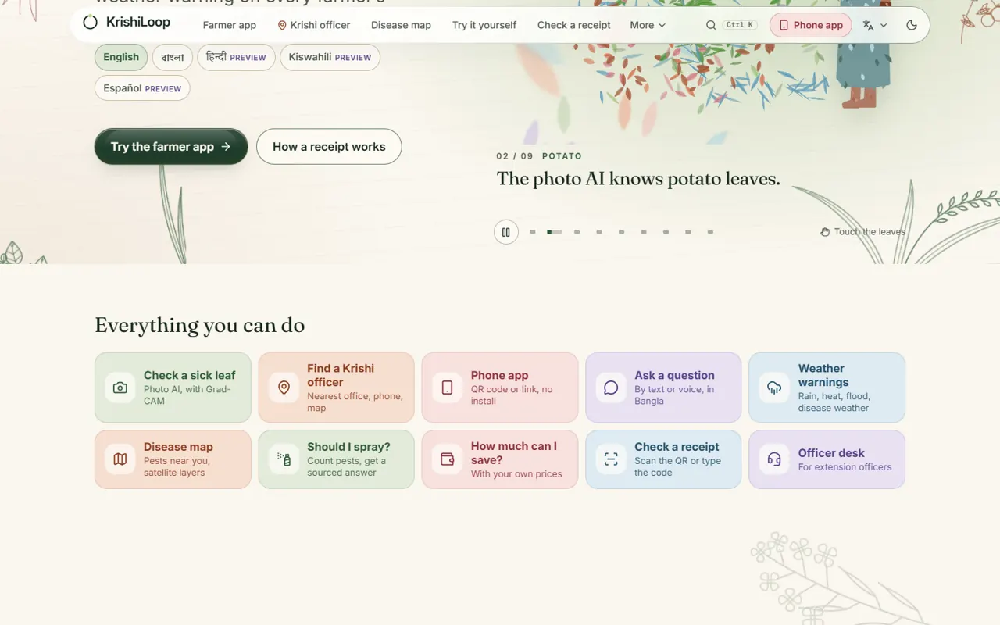
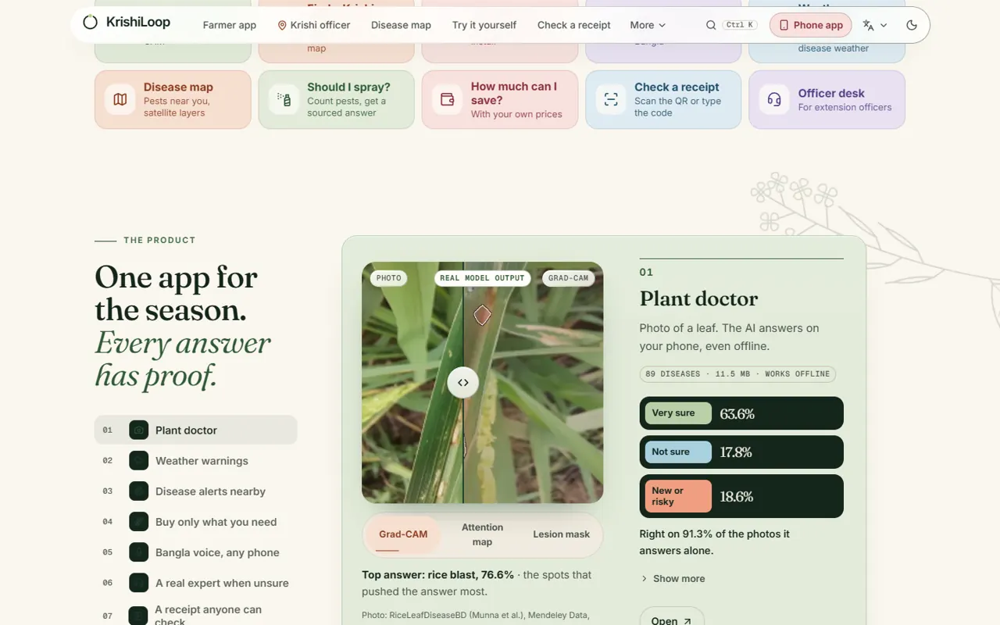
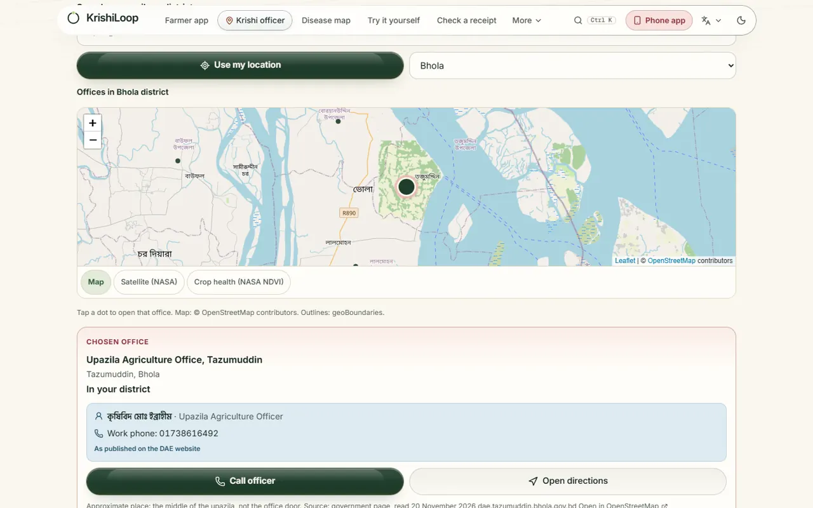
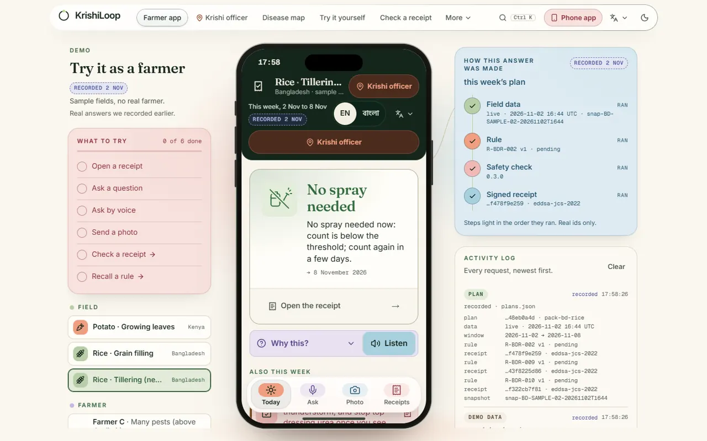
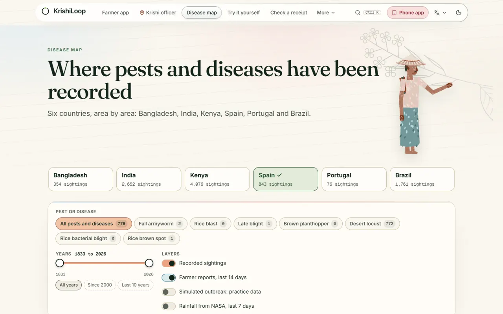
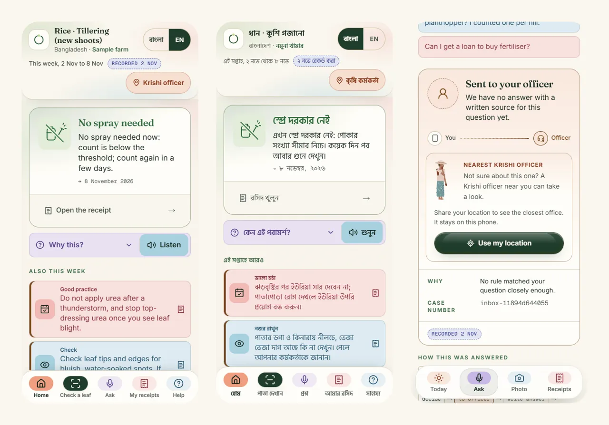
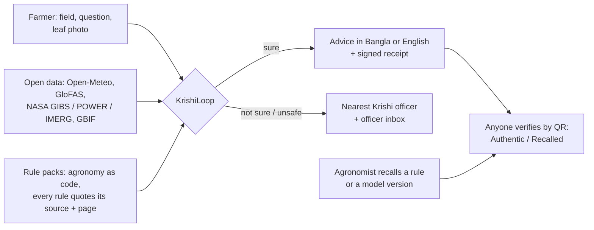
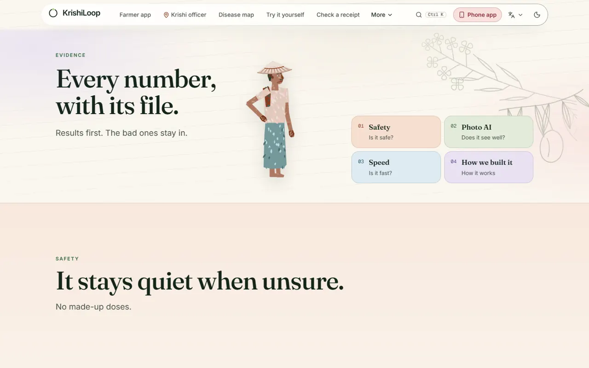

<p align="center">
  
</p>

<h1 align="center">KrishiLoop</h1>

<p align="center">
  <b>A plant doctor, farm adviser and weather warning on every farmer's phone, in their own language.</b><br>
  Every answer comes with a receipt anyone can check, and if it turns out wrong, we recall it from every farmer who got it.
</p>

<p align="center">
  <a href="https://krishiloop.vercel.app"></a>
  <a href="https://krishiloop.vercel.app/m"></a>
  <a href="https://krishiloop.vercel.app/proof"></a>
</p>
<p align="center">
  <a href="https://github.com/krishiloop/krishiloop/actions/workflows/ci.yml"></a>
  
  
  
</p>

<p align="center"><i>International AI Builders Congress 2026 · AgriSphere AI · Idea to Unicorn</i></p>

<p align="center">
  
</p>

---

## Try it in one minute

No login, no install. The live site runs in **sample mode**: real answers saved from our server, every one labelled "Saved" on screen.

| Open | What you see |
|---|---|
| [**Farmer app**](https://krishiloop.vercel.app/app) | This week's advice for a sample field, a signed receipt, Listen in Bangla, Ask, Photo |
| [**Phone app**](https://krishiloop.vercel.app/m) | The same app made for phones. Scan the QR under **Phone app** in the site's top bar |
| [**Find a Krishi officer**](https://krishiloop.vercel.app/krishi-officer) | The nearest upazila agriculture office, its officer and phone, a map and directions |
| [**Disease map**](https://krishiloop.vercel.app/map) | Six countries, NASA satellite pictures, crop health (NDVI), weather and rainfall |
| [**Check a receipt**](https://krishiloop.vercel.app/verify) | Scan a receipt's QR: **Authentic**, **Recalled** or **Cannot verify** |
| [**Try it yourself**](https://krishiloop.vercel.app/try) | The real tools: should I spray, check a leaf photo, weather warnings, savings, take advice back |
| [**Officer desk**](https://krishiloop.vercel.app/officer) | The extension officer's inbox, rules and recalls, outbreak radar |
| [**Evidence**](https://krishiloop.vercel.app/proof) | Every result, good and bad, with the file it comes from |

<p align="center">
  
</p>

## The problem

- **608 million farms** feed the world and **84% are under 2 hectares** (FAO, 2019). Pests and pathogens take an estimated **30% of rice** and **17% of potato** yields (Savary et al., 2019).
- In Bangladesh, our home market, **16.88 million households** live from farming (BBS census, 2019), and the national farm helpline **16123** answered **92,094 calls** between July 2025 and June 2026.
- AI farm advice is spreading, but nobody can check what an AI told a farmer, from which source, or take it back when it is wrong. In our own test on synthetic questions, **four open language models gave a dose nobody could check in 76% (85 of 112) of dose answers**.

## What KrishiLoop does

<table>
<tr>
<td width="50%" valign="top">

### Plant doctor, with real explainability
A photo of a leaf is read **offline, inside the phone's browser**, by our own 11.5 MB model (89 diseases). It shows **why**: true **Grad-CAM**, the **attention map** and a **lesion mask**. When it is not sure, it says so and hands the farmer to a person.

</td>
<td width="50%"></td>
</tr>
<tr>
<td width="50%"></td>
<td width="50%" valign="top">

### The nearest Krishi officer, always one tap away
When the AI is not sure, the app shows the nearest **upazila agriculture office** on a map: distance, **Call**, **Go there**, and the officer's name and work phone where the government's DAE website publishes them. All **544 upazilas**; the **Krishi Call Centre 16123** is always there.

</td>
</tr>
<tr>
<td width="50%" valign="top">

### A farm adviser that cites its source
This week's advice for the field ("no spray needed: the count is below the threshold"), with the source, page and rule behind it. **Listen** reads it in a natural Bangla or English voice. Ask questions by text or voice; an answer is a sourced rule or a hand-off to the officer, **never free AI text**.

</td>
<td width="50%"></td>
</tr>
<tr>
<td width="50%"></td>
<td width="50%" valign="top">

### Weather warnings and a disease map with NASA data
Seven-day warnings for heavy rain, heat, river flood and disease weather (Open-Meteo, GloFAS), each citing its rule. The disease map covers **Bangladesh, India, Kenya, Spain, Portugal and Brazil** (GBIF records), with **NASA GIBS** satellite and crop-health (NDVI) pictures, **NASA POWER** temperature, humidity and sunshine, and 7-day satellite rainfall per district from **NASA GPM IMERG**.

</td>
</tr>
<tr>
<td width="50%" valign="top">

### A receipt anyone can check, and recall
Every recommendation is a signed **W3C Verifiable Credential** (`eddsa-jcs-2022`) naming its source passage, page, data, and rule and model versions. Anyone can check it by **QR or a short SMS code**. If a rule, or the photo model itself, turns out wrong, we **recall** it and every receipt it touched turns **Recalled**.

</td>
<td width="50%"></td>
</tr>
</table>

## How it works



- **Decide:** a deterministic planner (no language model) turns rules and field data into one weekly decision. Questions go through a **LangGraph** router with **hybrid search** (BM25 + multilingual-e5) over sourced rules: the answer is a rule's validated text, or an abstention.
- **See:** the photo model is a **TinyViT-11M student distilled from DINOv2, CLIP and Perception Encoder**, with a **conformal safety gate** (diagnose, ask for a clearer photo, or refer) and an energy score for unknown photos.
- **Prove:** every answer is a signed credential; recall uses a W3C Bitstring Status List.
- **Reach:** five read-only **MCP servers** let other AI advisers verify our receipts and read our rules.
- **Data:** a **Kùzu** graph database links every rule, the source page it quotes and every receipt that used it, so a recall lists exactly the receipts it touches, and the Ask router uses the same graph for a **Graph RAG** step (sibling rules that cite the same page). Dense retrieval runs on a **LanceDB** vector table (multilingual-e5, 384 dimensions, rules and source chunks), and it ranks exactly as the in-memory search did. A **DuckDB** warehouse turns our rules, receipts, recalls, evaluations and GBIF sightings into Parquet and one SQL report (`tools/warehouse.py`, `ml/warehouse/REPORT.md`). All three are embedded: files, no database server to host.
- **Live:** `GET /api/events` streams new officer cases, recalls and photo-ledger events over **Server-Sent Events**. The officer console refreshes as they happen. Events carry ids and codes only, never personal data.
- **Look:** the design system is published as a [Claude Artifacts design system](https://claude.ai/artifact/7m8moHoKncYg7jwzRpDcai) (tokens, type, components, rules). The evidence page draws the per-model safety result with **Chart.js** and the warehouse's sightings per country with **D3.js** (`d3-scale`). The warehouse report's charts are **Vega-Lite** (Altair, rendered to SVG).
- **Run:** a **Prefect** flow chains the data refresh: contract checks, quote checks, the warehouse build and its tests (`tools/pipeline_flow.py`, last run in `ml/warehouse/PIPELINE_RUN.md`). Our MCP server was also called by a remote client through a temporary **Pinggy** tunnel, with its DNS-rebinding guard kept on (`docs/mcp-over-tunnel.md`).

## Results, each with its file

| What | Result | Where it comes from |
|---|---|---|
| Doses or brand names in answers | **0 of 400** held-out English and Bangla questions (synthetic) | `ml/evals/safety/ROUTER_FIX.md` |
| Receipts that verify | **99 of 99** | `ml/evals/safety/ROUTER_FIX.md` |
| Abstentions that reach a person | **361 of 361** | `ml/evals/safety/ROUTER_FIX.md` |
| Photo model, PlantWild test set | **77.4%** top-1; answers **63.6%** alone and is right on **91.3%** of those | `apps/web/public/models/agritriage/config.json` |
| Grad-CAM correctness | matches a numerical gradient to a relative error of **2e-9** | `apps/web/public/models/agritriage/evidence/xai_export.json` |
| Bangla speech recognition | **6.2%** character error (FLEURS) | `ml/voice/REPORT.md` |
| Voice readbacks | 35 clips ship, median **0.8%** transcription error; one held back at 14% | `ml/voice/results/gemini_roundtrip.json` |

**What did not work, published too:** our fine-tuned vision model was near chance on unseen datasets; two evaluation runs were invalid; the question router answered only **57%** of in-scope held-out questions (the rest went to the officer). We publish our negative results so the positive ones can be trusted.

<p align="center"></p>

## Run it locally

```bash
# Web app (React 19 + Vite + Tailwind CSS 4)
cd apps/web
npm ci
npm run dev                # http://localhost:5173 (sample mode without the API)
npm test                   # unit tests (Vitest)
npm run test:e2e           # browser tests (Playwright, uses your installed Chrome)

# API, engine and tests (Python 3.13)
python -m venv .venv
.venv/Scripts/python -m pip install -r requirements-dev.txt     # Windows (Git Bash); bin/python on Linux/macOS
.venv/Scripts/python tools/validate_contracts.py
.venv/Scripts/python tools/check_quotes.py
.venv/Scripts/python -m pytest -q
# The API needs KRISHILOOP_ISSUER_SEED (64 hex chars) and ADMIN_TOKEN in the environment;
# PUBLIC_BASE_URL is the address phones use for the QR codes.
.venv/Scripts/python -m uvicorn services.api.main:app --port 8000
```

## Repository map

| Path | What lives there |
|---|---|
| `apps/web/` | The website and both apps (farmer app `/app`, phone app `/m`), offline photo model, maps, voice |
| `services/engine/` | Weather snapshot, rule evaluation (a missing fact is never "no risk"), deterministic planner, dose and brand validator |
| `services/ask/` | The LangGraph question router (hybrid retrieval, safety screen, abstain to officer) |
| `services/trust/` | W3C Verifiable Credentials (`eddsa-jcs-2022`), status lists, did:web, recall |
| `services/vision/` | Server-side photo reading and explainability (same ONNX model as the phone) |
| `services/mcp/` | Five read-only MCP servers (weather, satellite, receipts, rules, photo trust) |
| `services/graph/` | The Kùzu provenance graph: rules, sources, quotes, receipts; recall blast radius; Graph RAG siblings |
| `tools/warehouse.py` | DuckDB + Parquet warehouse and its SQL report and Vega-Lite charts (`ml/warehouse/REPORT.md`) |
| `tools/pipeline_flow.py` | The Prefect flow for the data refresh (contracts, quotes, warehouse, tests) |
| `rules/` | Rule packs (Bangladesh rice, Kenya potato), each rule with its verbatim source quote and page |
| `contracts/` | JSON Schemas for plans, receipts, credentials, inbox items and more, validated in CI |
| `ml/` | Vision, voice, safety and token evaluations, each with its report |
| `tools/` | Data builders (offices, map, NASA rainfall, voice clips), quote and contract checks |
| `specs/`, `AGENTS.md`, `CLAUDE.md` | Spec-first development and the hard rules every coding agent follows |

## Honest limits

- The live demo runs in **sample mode** (saved answers); our API is not yet deployed publicly.
- Every rule **awaits expert review**; the Bangla, Hindi, Swahili and Spanish texts await native-speaker review.
- The photo model's weights are **research weights trained on PlantWild (CC BY-NC-ND 4.0), non-commercial**; a commercial version would retrain on licence-checked data.
- Office locations are upazila centres, marked approximate; officer names and phones are shown only as the government publishes them.
- Input savings and loss reduction will be measured in a pilot; they are not measured yet.

## Team

| Name | Role |
|---|---|
| Abdullah Rubab | Team lead · AI/ML engineer · Domain expert |
| Md. Tanvir Hasan | Product/UX designer · UI developer |
| Md. Sadman Al Islam Shabab | Full-stack developer · Product/UX designer |
| Sourov Kumar | Domain expert · Idea generation |
| Anushree Gope | Reviewer · Testing |

Built with AI, honestly disclosed: Claude Code (Opus, Sonnet and Haiku agents) wrote most of the code under the team's direction and review; the team also used Gemini, Google Antigravity, ChatGPT and Grok. No language model writes the agronomy.

## Licences and credits

- **Code:** Apache-2.0 (`LICENSE`).
- **Data and documents keep their own licences**, listed in `corpus/manifest.yaml` and on the [evidence page](https://krishiloop.vercel.app/proof):
  - Pérez, W. & Forbes, G. (2010). *Potato late blight: Technical manual.* International Potato Center (CIP). Reproduced with acknowledgement, as the publisher's statement invites.
  - BRRI rice documents are cited by title, page and short quotes only (permission requested).
  - Open-Meteo and GloFAS (CC BY 4.0); NASA EOSDIS GIBS, NASA POWER and NASA GPM IMERG (GES DISC); GBIF occurrence data (per-dataset licences); geoBoundaries (CC BY 3.0 IGO and per-country licences); OpenStreetMap (ODbL); DAE upazila websites (Bangladesh National Portal).
  - The rice-blast photo on the home page: RiceLeafDiseaseBD (Munna et al.), Mendeley Data, CC BY 4.0.
